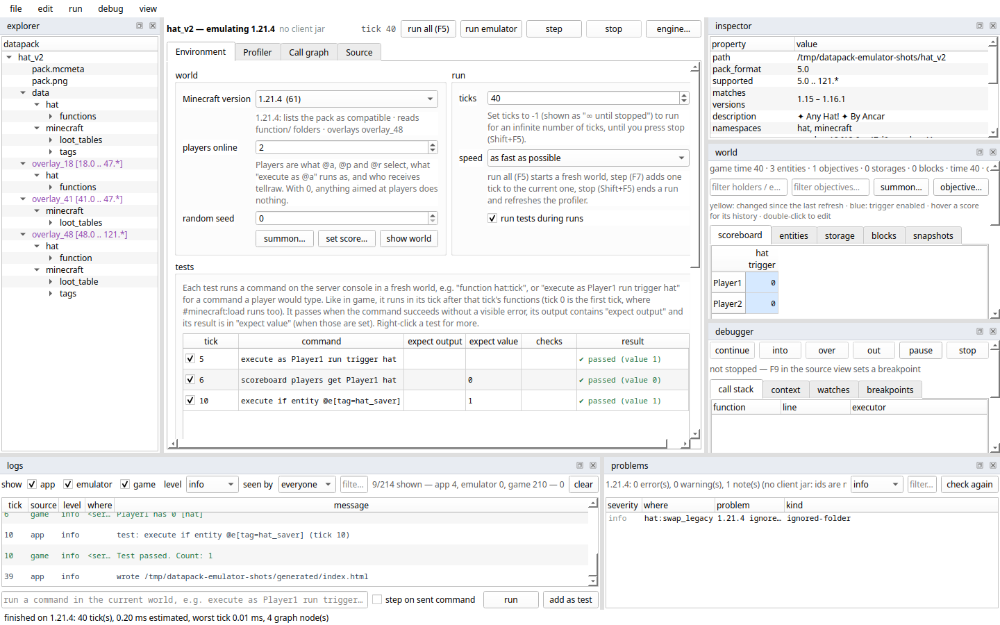
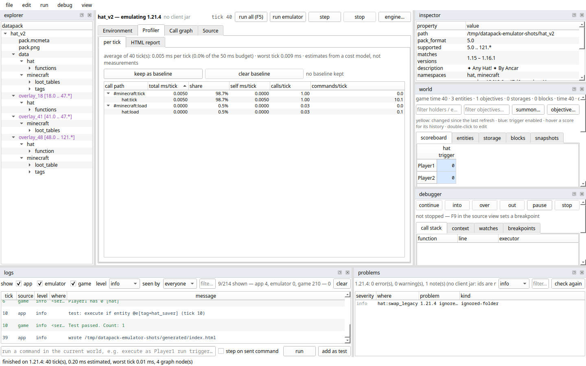
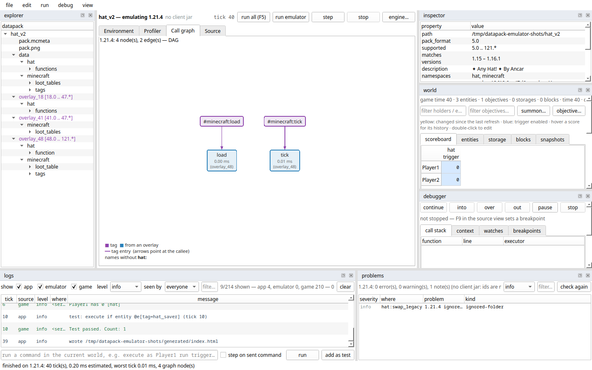
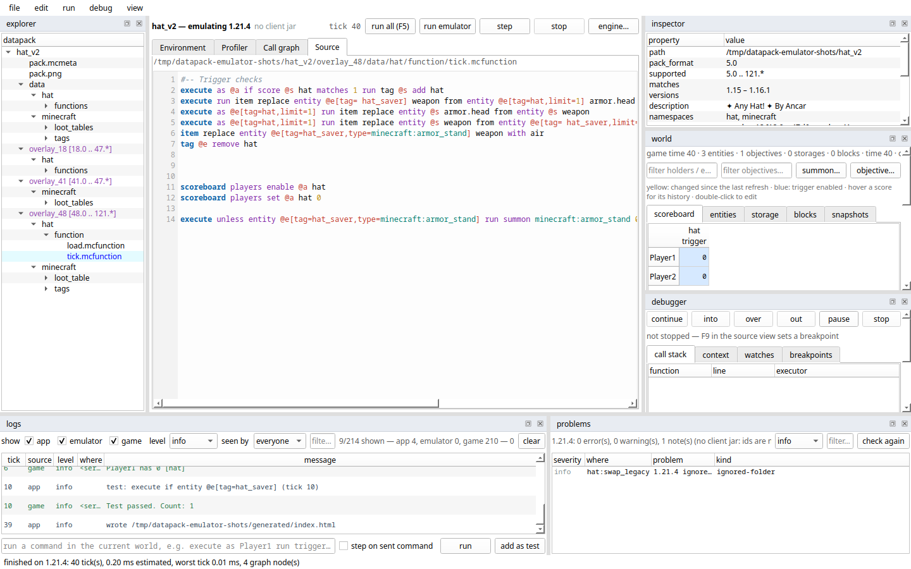
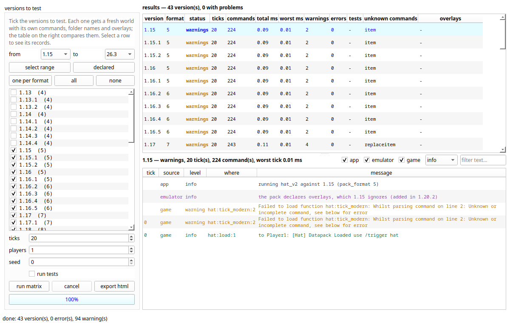

# Datapack Emulator

Run a Minecraft datapack without starting Minecraft. Load it, tick it, and see
what its functions print, what they cost and how they call each other — for
**any Minecraft version from 1.13 to 26.3**, checked against the real base
game read out of a `client.jar`.



It comes as a window (PySide6) and as a command line that does everything the
window does, so the same checks run on your desk and in CI.

## What it does

**Runs the pack.** `#minecraft:load` and `#minecraft:tick`, scoreboards,
selectors, `execute`, macros, schedules, storage, entity NBT and inventories,
blocks (setblock, fill, clone, containers, block entity data), teams, game
modes, experience, time, weather, the world border, random sequences, health,
attributes, effects, riding, boss bars, item entities, predicates,
advancements, and loot tables with their conditions and functions.
Minecraft's own error messages are printed as the game would, kept apart from
the app's logs. See [what is emulated](docs/emulation.md).

**Knows every version.** Which commands exist in each version from 1.13 to
26.3, how each one spells its folders, and which `pack.mcmeta` overlays apply.
The version engine runs the pack across a whole range at once and compares
the results.

**Shows the world as it runs.** A scoreboard grid with each score's history,
entities with their full NBT, command storage and placed blocks — and a
console that runs commands typed into it. World snapshots keep a world aside,
rewind to it, and compare two to see what a tick changed.

**Tests it.** Commands at any tick, with checks on scores, storage, NBT,
blocks and entity counts — in the window, during runs, across versions, and
in CI: `datapack-emulator-cli test` exits non-zero on a failure and writes
JUnit XML.

**Finds problems.** One list for the whole pack, per version, worst first:
what stops the world or the pack from loading at all (worldgen and dimension
files missing a required field or using a removed kind, broken JSON there, an
unreadable `pack.mcmeta`), then functions that do not load, unknown selector
options, bad SNBT and ids, missing functions, broken loot tables and
predicates, unused functions.

**Profiles it.** Per-function cost from constants measured on a real server,
the dearest lines, a flame graph, a before/after comparison of two runs, and
the call graph as a DAG.

**Edits and debugs.** Functions are edited in the window, each line checked as
you type, with completion (Ctrl+Space) and renaming a function across the pack
(F2). The debugger has breakpoints (with conditions) on function lines, step
into / over / out, the call stack, the command source and watched scores,
storage and NBT — in the window and in the command-line shell. Any command
line can be explained: execute steps, selectors, references, version support
and cost.

**Reads the base game** — registries, tags and message strings — straight
from a `client.jar`, downloaded for you on request.

## Screenshots

| | |
| --- | --- |
|  |  |
| **Profiler** — estimated cost per function and call path, per tick | **Call graph** — function tags and the functions they call, overlays marked |
|  |  |
| **Source** — edit with live checks, breakpoints in the gutter | **Version engine** — the pack run on 43 versions, one row each |

The pictures are made by `python tools/screenshots.py` (on `samples/hat_v2`);
run it again after changing the window. The [window guide](docs/ui.md)
describes every panel.

## Quick start

```sh
python -m venv .venv
.venv/bin/pip install -e ".[gui]"

.venv/bin/datapack-emulator          # the window; press F5 (it reopens the last project)
.venv/bin/datapack-emulator samples/hat   # or open this pack; --no-last-project for the sample
```

Or, from a checkout, `src/main.sh` (uses `.venv/` or `src/.venv/` if present,
no install needed beyond the requirements).

An installed copy (a wheel, or a folder built with PyInstaller) has no
`samples/`: it carries a starter pack inside the package, which the window
copies into your samples folder and opens on a cold start (the command line
does the same with `datapack-emulator-cli project samples --install`). See
[docs/releases.md](docs/releases.md) for building and publishing one.

The project opened most recently comes back on startup (the first sample pack
when there is none). New to it? [Getting started](docs/getting-started.md)
walks through a first run.

## Command line

`datapack-emulator-cli` does what the window does — run, test, profile,
inspect, explain, search, complete, rename, the fields a version's own files
hold, the call graph, the world, an interactive console with a debugger and
project editing — on packs or saved projects. It needs nothing beyond the
standard library. See [docs/cli.md](docs/cli.md).

```sh
.venv/bin/datapack-emulator-cli run    samples/hat_v2 --version 1.21.4 --vanilla
.venv/bin/datapack-emulator-cli matrix samples/hat_v2 --declared --boundaries
.venv/bin/datapack-emulator-cli test   projects/hat.dpemu --junit generated/tests.xml
.venv/bin/datapack-emulator-cli shell  samples/hat          # type commands, .step, .scores, .help
.venv/bin/datapack-emulator-cli shell  samples/hat --break hat:tick:2 --watch "score Player1 hat"   # debug
.venv/bin/datapack-emulator-cli world  samples/hat --ticks 5 --scores
.venv/bin/datapack-emulator-cli check  samples/hat --declared --boundaries
src/main.sh --cli run samples/hat_v2 --version 26.3      # same runner through the script
```

## For scripts and AI agents

The core installs with no dependencies (`pip install datapack-emulator`) and
answers in JSON, from Python or the command line:

```python
from datapack_emulator import agent

agent.check("my_pack", version="1.21.4")              # what the version refuses to load
agent.run("my_pack", version="1.21.4", ticks=40,      # tick it, then ask the world
          commands=["scoreboard players get #game timer"])
agent.test("my_pack", ["5:"], checks=["score #game timer = 5"])
agent.matrix("my_pack", declared=True, boundaries=True)
```

```sh
datapack-emulator-cli --quiet run my_pack --version 1.21.4 --json
```

Every result has `ok` and a one-line `summary`; `ok` is false for the silent
failures a real server only warns about (a function that does not parse,
`functions/` folders on 1.21+). See [docs/agents.md](docs/agents.md). The
[minecode-mcp](https://github.com/AnCarsenat/minecode-mcp) server exposes it
as MCP tools.

## Documentation

Everything is in [`docs/`](docs/README.md):

* [getting started](docs/getting-started.md) · [the window](docs/ui.md) ·
  [projects](docs/projects.md) · [command line](docs/cli.md) ·
  [scripts and AI agents](docs/agents.md)
* [versions & overlays](docs/versions.md) ·
  [base game from client.jar](docs/vanilla-assets.md) ·
  [what is emulated](docs/emulation.md) · [version engine](docs/engine.md) ·
  [cost model](docs/costs.md)
* [architecture](docs/architecture.md)

Timings come from a cost model whose constants were **measured on a real
Minecraft server** — a lower bound and a ranking, not a tick-time
prediction. For real timings of your own pack, `datapack-emulator-cli
server-profile` reads a server's `/perf` report; `calibrate` measures the
model on your machine. See [costs.md](docs/costs.md).

## Layout

```
src/datapack_emulator/emulator/   model, commands, runtime, analysis, version engine (no Qt)
src/datapack_emulator/window/     window.ui, engine.ui, download.ui, and the code that wires them
src/datapack_emulator/cli/       the command line: datapack-emulator-cli (no Qt)
src/datapack_emulator/project.py  .dpemu project files
src/main.sh     starts the window (or --cli) from a checkout
tests/          pytest suite (no network, no Minecraft install needed)
tools/          generate_version_data.py, apply_calibration.py, screenshots.py
docs/           documentation (docs/screenshots/: the pictures in this readme)
samples/        example datapacks
projects/       your saved .dpemu projects (git-ignored)
generated/      reports and .dot files   (git-ignored)
.cache/         downloaded client jars   (git-ignored)
```

## Contributing

Bug reports, command handlers, UI work and docs are welcome — see
[CONTRIBUTING.md](CONTRIBUTING.md) for setup, ground rules and the checks CI
runs.

## License

GPL-3.0 — see [LICENSE](LICENSE).
